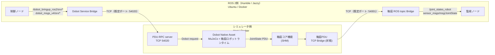
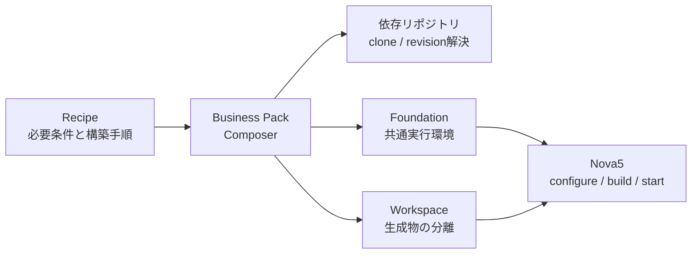

# hakoniwa-robot-arm

`hakoniwa-robot-arm` は、URDF / Xacro で記述されたROSロボットモデルをもとに、箱庭上でロボットアームシミュレータを構築・実行するためのシミュレーション開発基盤です。

ロボットモデルをMuJoCo形式へ変換し、[箱庭ロボットランタイム](https://github.com/hakoniwalab/hakoniwa-robot-runtime)と組み合わせることで、実機を使用せずに関節制御や状態取得を行えます。Nova5 は箱庭単体、ROS 2 からの箱庭操作、Ubuntu host-ros2 での実機接続の3段階で利用できます。ROS 2 では Dobot 公式 `dobot_msgs_v4/srv/*` サービスと `/joint_states_robot` を使い、箱庭に対して無改変の公式デモを実行します。

現在の対応状況：

| Robot | 状況 |
| --- | --- |
| DOBOT Nova5 | Ubuntu 24.04 native host-ros2、Windows 11 native host-standalone／host+Docker（Jazzy）、macOS host+docker（Jazzy）、Linux arm64 docker-only（Humble／Jazzy）の従来経路で動作確認済み。Dobot 仮想サービス経路の検証状況は[こちら](ros2_packages/hakoniwa_dobot/README.md#検証済みと未検証)。 |
| FAIRINO FR5 | ソースとツールを公開。動作確認中。 |
| SO-101 follower | ソースとツールを公開。動作確認中。 |
| MathScavator9000 Excavator | macOS host、WSL2 Ubuntu 24.04、Windows 11 native（いずれもheadless）で走行を動作確認済み。Viewer表示とその他の環境は未確認、掘削は実験的。詳細は[Recipe](recipes/excavator/README.md)。 |

ロボットの種類毎の設定や実行手順は[対応ロボット](docs/reference/robots.md)を参照してください。

## 初めての方へ

最初に、[クイックスタート](#クイックスタート)の「checkout用workspaceを作る」から開始してください。手動でcloneするのは、同じ親ディレクトリに置く次の2リポジトリだけです。

- `hakoniwa-business-pack` — Composer、Workspace、Foundationを提供します。
- `hakoniwa-robot-arm` — ロボット固有のRecipe、設定、アプリケーションを提供します。

その他の依存リポジトリとRobot Modelは、後続のRecipe操作で必要に応じて取得します。2リポジトリのclone後に、利用する環境に応じてhost-standalone、windows-host-standalone、windows-host-docker、host-ros2、host+docker、docker-onlyの手順を選んでください。

## ドキュメント

ドキュメントは用途別に分けています。最初は[利用ガイド](docs/README.md)から、利用する環境の手順を選んでください。

- [実行手順](docs/procedures/README.md): setup、build、operation、ROS 2操作
- [設計文書](docs/design/README.md): Recipe、profile、生成物、ROS 2接続
- [参照資料](docs/reference/README.md): 対応ロボット、Model Forge
- [ライセンス情報](docs/license/README.md): 依存OSS、Robot Model、再配布方針

## できること

- URDF / Xacroで記述されたロボットモデルをMuJoCo形式へ変換
- MuJoCoによるロボットアームの物理シミュレーション
- 箱庭ロボットランタイムによる関節制御
- [Dobot公式ROS 2サービスを使ったNova5操作](docs/procedures/ros2/arm-operations.md)（箱庭が既定、Ubuntu host-ros2 の実機 `real`／`both` は発展構成）
- ROS 2 `/joint_states_robot` による状態取得
- 公式 `dobot_demo/demo.py` を変更せず virtual で実行（実機・both では 50° 動作に注意し実行しない）
- Dockerを利用したROS 2実行環境
- Host上のMuJoCo Viewerを利用したシミュレーション可視化

## アーキテクチャ

シミュレータ側と ROS 2 側を TCP で分離します。Dobot 公式 ROS サービスは Service Bridge → PDU-RPC → Dobot Native Asset に接続し、関節状態は既存 TCP/PDU Bridge から `/joint_states_robot` へ remap します。ROS のサービス／topic は ROS 2 側で終端します。



### シミュレータの構成

シミュレータ側では、MuJoCo と箱庭ロボットランタイムが物理シミュレーション、Dobot サービスの受付、関節状態の出力を行います。PDU-RPC はサービス要求を Native Asset に送り、箱庭 PDU TCP Bridge は SHM 上の関節状態を ROS 2 側へ中継します。Viewer と headless を選択できます。

### ROS 2側の構成

`dobot.launch.py` は既定で箱庭の Service Bridge と topic Bridge を同時に起動します。制御には `dobot_msgs_v4/srv/GetAngle`、`MovJ`、`ServoJ` など、観測には `sensor_msgs/msg/JointState` を使用します。仮想 `MovL` の joint mode は関節空間の近似で Cartesian 直線ではなく、仮想 `DO` は 1～24 の状態／パルスのみで物理グリッパーはありません。[対応 API と安全上の注意](docs/procedures/ros2/arm-operations.md)を参照してください。

### 箱庭ロボットランタイム

箱庭ロボットランタイムは、ロボットごとの挙動や通信構成を定義ファイルから組み立てる共通基盤です。主に以下を入力として、物理モデル、制御入力、状態出力、通信経路を構成します。

- 箱庭アセットマニフェスト
- MuJoCoモデル（MJCF）
- PDU定義とPDU通信定義
- アクチュエータ、コントローラ、センサ設定

本リポジトリは各対応ロボット用の設定値と設定ファイルの組み合わせを所有し、各項目の意味、参照関係、検証規則は`hakoniwa-robot-runtime`を正本とします。通常利用ではこれらの設定を変更する必要はありませんが、ロボット構成や制御方法を変更する場合は、次の文書を参照してください。

- [Robot Runtime Configuration](https://github.com/hakoniwalab/hakoniwa-robot-runtime/blob/main/docs/configuration.md): Asset Manifest、Runtime、actuator、controller、state-output、PDU、Endpointの設定仕様と参照関係
- [Robot Runtime Design](https://github.com/hakoniwalab/hakoniwa-robot-runtime/blob/main/docs/design.md): Runtimeの責務、内部構成、Adapterとの境界
- [Runtime-owned JSON Schemas](https://github.com/hakoniwalab/hakoniwa-robot-runtime/tree/main/schemas): Runtimeが所有する機械可読な設定Schema
- [Hakoniwa PDU Endpoint Schemas](https://github.com/hakoniwalab/hakoniwa-pdu-endpoint/tree/main/config/schema): PDU Definition、PDU Types、Endpoint、Cache、Comm形式の正本

具体的な設定例として、Nova5では次のファイルを使用します。FR5／SO-101／MathScavator9000にも`recipes/<robot>/`以下に機種固有の設定があります。

| 設定 | Nova5の設定ファイル | 主な役割 |
| --- | --- | --- |
| Asset Manifest | [`recipes/nova5/asset-manifest.json`](recipes/nova5/asset-manifest.json) | モデル、PDU、Endpoint、Runtime componentを束ねる入口 |
| Runtime | [`recipes/nova5/config/runtime.json`](recipes/nova5/config/runtime.json) | actuator Runtimeの共通設定とcommand timeout |
| MuJoCo actuator | [`recipes/nova5/actuator.yaml`](recipes/nova5/actuator.yaml) | position actuatorの`kp`、`dampratio`、`ctrlrange`。ゲイン変更は再Forgeが必須。調整手順は[Model Forge](docs/reference/model-forge.md#4-kpとdampratioの調整)を参照 |
| Actuator / Controller / State Output | [`recipes/nova5/config/`](recipes/nova5/config) | joint binding、軌道制御、関節状態出力 |
| PDU Definition / Types | [`recipes/nova5/config/pdu/`](recipes/nova5/config/pdu) | Nova5が使用するPDU robot、channel、message type |
| Endpoint | [`recipes/nova5/config/endpoint/nova5_endpoint.json`](recipes/nova5/config/endpoint/nova5_endpoint.json) | PDU Definitionと通信backendの選択 |

`nova5.py configure`がwork側へ生成する`launcher.json`や、Forgeが生成するMJCFは手作業で編集しません。Dobot構成は[専用の変換ツール](docs/procedures/ros2/dobot-build.md)を使ってLauncherを切り替え、再configure後は再適用します。変更対象ごとのForge／configure／buildの区別、生成先、反映確認は[設定変更と反映方法](docs/design/configuration-workflow.md)を参照してください。

## ライセンスとRobot Model

別途ライセンス表示のある第三者成果物を除き、本リポジトリ自身のソースコード、設定、ツール、文書には、ルートの[Apache License 2.0](LICENSE)が適用されます。利用するHakoniwa OSSと外部OSSには、それぞれのライセンスが適用されます。詳細は[依存コンポーネントのライセンス一覧](docs/license/dependencies.md)を参照してください。

上流のURDF、Xacro、MJCF、mesh、CAD、textureなどのRobot Model本体と、Forgeで生成した派生成果物は、本リポジトリへ同梱・再配布しません。利用者自身が固定revisionから取得し、`$HAKONIWA_WORK_DIR/model-forge/`以下へ生成します。本リポジトリが管理するのは、取得・変換の定義、箱庭固有の設定、およびライセンス調査の記録です。

各モデルの取得元、固定revision、確認したライセンス宣言、再配布上の注意は、[Robot Modelのライセンス情報](docs/license/robot-models.md)を参照してください。この台帳にはNova5、FR5、SO-101、MathScavator9000の調査結果を掲載しています。本リポジトリのApache License 2.0が、第三者モデルまたはその派生成果物へ自動的に適用されるものではありません。

モデルごとの`source.yaml`と`LICENSE_INFO.yaml`は、次のように責務を分けています。変換・正規化の手順は、対応するForge Recipeとツールで管理します。

| ファイル | 責務 |
| --- | --- |
| `source.yaml` | Forgeが取得する上流repository、固定revision、対象ファイルを指定する取得定義 |
| `LICENSE_INFO.yaml` | 固定revisionで確認したライセンス根拠、未確定事項、再配布の判定と必要な対応を記録する調査台帳 |

これらはモデル本体を含まず、また法的助言ではありません。上流モデルまたはForge生成物を外部へ再配布する前には、対象モデルの台帳と上流のライセンス本文・NOTICE・package metadataを確認してください。

## 箱庭Business Packとの関係

[hakoniwa-business-pack](https://github.com/hakoniwalab/hakoniwa-business-pack)は、箱庭シミュレーションに必要な依存関係、共通実行環境、ビルド手順を管理するComposerです。本リポジトリはロボット固有のモデル、設定、アプリケーションを提供し、環境の構築と分離にはBusiness PackのWorkspace、Foundation、Recipeの仕組みを利用します。



### Workspace

Workspaceは、使用するFoundationと生成物を他の作業環境から分離するための実行環境です。`workspace.py enter --workdir <path>`で専用シェルへ入り、選択したパスが`HAKONIWA_WORK_DIR`に設定されます。子シェルの開始ディレクトリは`hakoniwa-business-pack`のリポジトリルート（`tools/`ディレクトリがある場所）です。Foundation、Forge、Recipeのビルド、設定、ログ、セッションは、作業ディレクトリではなく選択したworkディレクトリ以下へ生成されます。

### Foundation

Foundationは、複数のシミュレーションで再利用する箱庭の共通実行環境です。Nova5では、箱庭コア、PDU Endpoint、PDU Bridge、Python API、Launcher、および実行時設定を`HAKONIWA_WORK_DIR/foundation/`以下へ構築します。

### Recipe

Recipeは、「何が必要で、どのrevisionを使い、何を構築・検証するか」を記述したYAMLファイルです。Business Packの`tools/recipe.py`はRecipeを読み、次の処理を行います。

- `plan`: clone、checkout、再利用、Foundationビルドの予定を表示
- `configure`: 依存リポジトリを準備し、必要なFoundationとPython依存を構築
- `doctor`: FoundationとRecipe依存が実行可能な状態か検査

本リポジトリの`tools/recipe/<robot>.py`は、その環境を利用して各ロボット固有のForge、configure、build、start、stopを実行します。対応するentrypointと置換方法は[対応ロボット](docs/reference/robots.md)を参照してください。

## 動作確認環境

| 項目           | 確認環境                                |
| ------------ | ----------------------------------- |
| Host OS      | macOS（Apple Silicon） / Ubuntu 24.04 / Windows 11（native host-only／host+Docker） |
| ROS 2        | Humble / Jazzy                      |
| MuJoCo       | 3.16.0                              |
| 箱庭側 Python   | 3.12                                |
| Build System | CMake / colcon                      |

macOS の host+docker では ROS 2 を Docker Container 上で、箱庭の Native Asset を Host 上で実行します。Windows 11 の箱庭単体 Runtime と旧 ROS topic 経路は確認済みですが、[Dobot Native Asset / RPC を使う Windows host+Docker 手順](docs/procedures/windows-host-docker/build.md)は未検証です。各段階の成功判定を確認して進んでください。既存の動作確認実績を新サービス経路の検証済みと混同しないでください。

Ubuntu 24.04 native host-ros2 の従来経路は動作確認済みです。Dobot 仮想サービス経路の各 platform の検証状況は[Dobot の説明](ros2_packages/hakoniwa_dobot/README.md)を参照してください。

## 前提ソフトウェア

選択する利用構成に応じて、Hostへ以下をインストールしてください。

| ソフトウェア | 用途 |
| --- | --- |
| Git | すべての構成で、本リポジトリとBusiness Packを取得するために使用 |
| CPython 3.12 | host-standalone／host-ros2／host+dockerで、Business Pack、Foundation、Recipeツールを実行。`python3.12`コマンドで起動できること |
| CMakeとC/C++ビルド環境 | host-standalone／host-ros2／host+dockerで、FoundationとNova5シミュレータをビルド |
| Docker | host+dockerまたはdocker-only構成でのROS 2実行 |

macOSではXcode Command Line Tools、UbuntuではC/C++コンパイラを含む標準的なビルド環境も必要です。

すべての構成でGitを確認します。

```bash
git --version
```

host-standalone、host-ros2、host+dockerのいずれかを選ぶ場合は、Host側のPythonとビルド環境も確認します。

```bash
python3.12 --version
cmake --version
```

host+dockerまたはdocker-onlyを選ぶ場合は、追加でDockerを確認します。

```bash
docker --version
```

## 利用構成

### 段階1：ROS 2を使わず箱庭単体で動かす

同じ Nova5 モデルを箱庭 Runtime と MuJoCo Viewer で動かし、箱庭 PDU と独自の軌道スクリプトを使います。公式 ROS サービスや Dobot 用 PDU-RPC は不要です。

| 環境 | 構成 |
| --- | --- |
| Ubuntu／macOS Host | `host-standalone`（Bash。macOS は Homebrew で前提を準備） |
| Windows 11 native Host | `windows-host-standalone`（PowerShell） |

### 段階2：ROS 2から箱庭を動かす

環境は異なりますが、いずれも箱庭側の Nova5 と ROS 2 側の Dobot 公式サービスを接続し、**箱庭だけで**無改変の `dobot_demo demo` を動かします。ROS launch の既定は箱庭（`virtual`）で、利用者が実機モードを選ぶ必要はありません。公式ソースから `dobot_msgs_v4` と `dobot_demo` をビルドし、箱庭との通信に必要な `dobot-types` を生成します。実機 driver はビルドしません。

| 環境 | 構成 |
| --- | --- |
| Ubuntu Host（ROS 2と箱庭を同じHostで実行） | `host-ros2` |
| macOS Host＋Ubuntu ROS 2 Container | `host+docker` |
| Windows 11 native Host＋Ubuntu ROS 2 Container | `windows-host-docker`（Dobot Native Asset／RPCのビルド・結合は未検証） |
| Ubuntu／macOS／Windows Host＋単一 Ubuntu Container | `docker-only`（macOS／Windowsではheadless。Windows Hostからの Bash 手順は未検証） |

### 段階3：Ubuntu host-ros2から実機にも接続する（発展）

段階2の `host-ros2` で箱庭動作を確認した後に、公式実機 driver を**追加ビルド**し、`real`（実機のみ）または `both`（実機と箱庭）を選びます。Ubuntu Native での実機動作は確認済みです。公式デモは50°の絶対移動を含むため実機へ送らず、現在姿勢からの小動作で確認します。

## クイックスタート

### 共通：checkout用workspaceを作る

利用者が置きたい親ディレクトリで次のコマンドを実行し、空のディレクトリを作って、その直下へBusiness Packと本リポジトリをcloneします。

```bash
mkdir -p hakoniwa-robot-arm-workspace
cd hakoniwa-robot-arm-workspace
git clone https://github.com/hakoniwalab/hakoniwa-business-pack.git
git clone https://github.com/teras-project/hakoniwa-robot-arm.git
```

この時点では2リポジトリだけで構いません。標準配置では、後続のprofileがこの兄弟配置を自動検出します。Nova5が必要とする他のリポジトリは、Recipeの`configure`またはROS 2 workspaceの`build`が自動取得します。

### 段階1：箱庭単体で確認する（ROS 2なし）

#### Ubuntu／macOS：host-standalone

1. [箱庭単体セットアップ](docs/procedures/host-standalone/setup.md)
2. [箱庭単体ビルド](docs/procedures/host-standalone/build.md)
3. [箱庭単体の起動・動作確認](docs/procedures/host-standalone/operation.md)

両OSともROS 2やDockerは不要です。セットアップ手順の冒頭で、Ubuntuは`apt`、macOSはHomebrewの前提コマンドを選んでください。

#### Windows native：windows-host-standalone

1. [Windows native箱庭単体セットアップ](docs/procedures/windows-host-standalone/setup.md)
2. [Windows native箱庭単体ビルド](docs/procedures/windows-host-standalone/build.md)
3. [Windows native箱庭単体の起動・動作確認](docs/procedures/windows-host-standalone/operation.md)

### 段階2：ROS 2から箱庭を動かす

以下から実行環境を1つ選び、setup → build → operation の順に進みます。共通のゴールは **実機を接続せず、公式 `dobot_demo demo` を箱庭で動かすこと**です。

#### Ubuntu Host：host-ros2

1. [Host ROS 2連携セットアップ](docs/procedures/host-ros2/setup.md)
2. [Host ROS 2連携ビルド](docs/procedures/host-ros2/build.md)
3. [Host ROS 2連携の起動・動作確認](docs/procedures/host-ros2/operation.md)

#### macOS Host＋Docker：host+docker

macOSでは、Nova5 RuntimeとMuJoCo ViewerをHost、ROS 2 BridgeとROSノードをDocker Containerで実行します。HostとDockerはTCPで接続します。

1. [host+dockerセットアップ](docs/procedures/host-docker/setup.md)
2. [host+dockerビルド](docs/procedures/host-docker/build.md)
3. [host+docker起動・動作確認](docs/procedures/host-docker/operation.md)

人が操作する場合はHost上のMuJoCo Viewerを利用できます。CIや画面のない自動確認ではheadlessを選択します。

#### Windows Host＋Docker：windows-host-docker

Windows 11 の native Runtime と ROS 2 Jazzy Docker Desktop の構成です。Dobot 仮想サービスは基本経路ですが、Windows native のビルドと結合は未検証です。各段階の確認に失敗したら先へ進まないでください。

1. [Windows host+Dockerセットアップ](docs/procedures/windows-host-docker/setup.md)
2. [Windows host+Dockerビルド](docs/procedures/windows-host-docker/build.md)
3. [Windows host+Docker起動・動作確認](docs/procedures/windows-host-docker/operation.md)

#### Ubuntu／macOS／Windows Host：docker-only

HostへCPython 3.12、CMake、ROS 2などを導入せず、GitとDockerだけで動作確認したい場合はdocker-onlyを選択します。Nova5とROS 2を同じ1つのUbuntu Container内で実行します。

1. [docker-onlyセットアップ](docs/procedures/docker-only/setup.md)
2. [docker-onlyビルド](docs/procedures/docker-only/build.md)
3. [docker-only起動・動作確認](docs/procedures/docker-only/operation.md)

native Linux HostではViewerを利用できます。macOS Docker Desktopではnative architectureのheadless実行を使用します。Windows Hostからの Bash 手順は未検証です。

### 段階3：Ubuntu host-ros2 で実機にも接続する（発展）

段階2の `host-ros2` の箱庭デモまで完了した場合のみ、[実機 driver の追加と `real`／`both` への切り替え](docs/procedures/host-ros2/real.md)へ進みます。実機で無改変の公式デモは実行しません。

## リポジトリ構成

| パス | 責務 |
| --- | --- |
| `apps/` | 共通ランタイムを利用するアームシミュレータのアプリケーション |
| `recipes/nova5/` | Nova5のManifest、PDU、制御、Forge設定 |
| `recipes/ros2/` | ROS 2 TCP BridgeのRecipe |
| `ros2_packages/` | 標準colconでbuildするROS 2サンプルノード |
| `sources/models/` | 上流モデルの取得情報、出典、work内での正規化手順。取得したモデル本体は含まない |
| `tools/` | Forge、Recipe操作、環境生成、制御用ツール |
| `docker/` | ROS 2 Humble/Jazzy用のContainer環境 |
| `docs/procedures/` | 利用者が順番どおり実行する環境別手順 |
| `docs/design/` | Recipe、profile、生成物、接続関係の設計説明 |
| `docs/reference/` | 対応ロボットとModel Forgeの参照情報 |
| `docs/license/` | 依存OSSとRobot Modelのライセンス台帳 |

Forgeで取得・生成したモデルはソースツリーへ配置せず、`HAKONIWA_WORK_DIR/model-forge/`以下で管理します。ROS 2のvenv、build、install、logは`HAKONIWA_ROS2_WS`以下へ生成します。

## 必要なリポジトリ

リポジトリは原則として同じ親ディレクトリへ配置します。最初に手動でcloneするのはBusiness Packと本リポジトリだけです。

| リポジトリ | 準備方法 | 用途 |
| --- | --- | --- |
| `hakoniwa-business-pack` | 利用者がclone | Composer、Workspace、Foundation |
| `hakoniwa-robot-arm` | 利用者がclone | 本リポジトリ |
| `hakoniwa-core-pro` | runtime Recipeの`configure`が自動取得 | 箱庭コアとSHM |
| `hakoniwa-pdu-endpoint` | runtime RecipeおよびROS 2 workspaceが自動取得 | PDU通信Endpoint |
| `hakoniwa-pdu-bridge-core` | runtime Recipeの`configure`が自動取得 | Host側TCP Bridge |
| `hakoniwa-pdu-python` | runtime Recipeの`configure`が自動取得 | Python LauncherとPDU API |
| `hakoniwa-robot-runtime` | runtime Recipeの`configure`が自動取得 | 共通ロボットランタイム |
| `hakoniwa-mujoco-robots` | runtime／Forge Recipeの`configure`が自動取得 | MuJoCo共通機能 |
| `hakoniwa-mbody-registry` | Forge Recipeの`configure`が自動取得 | モデル取得・変換ツール |
| `hakoniwa-pdu-ros` | ROS 2 workspaceの`build`が自動取得 | ROS 2 Bridgeパッケージ |

自動取得されるリポジトリとrevisionはRecipeに記録されています。実行前に`tools/recipe.py plan`を使うと、clone、checkout、再利用、Foundationのビルド予定を確認できます。

```text
hakoniwa-robot-arm-workspace/
├── hakoniwa-business-pack/       # 手動clone
├── hakoniwa-robot-arm/           # 手動clone
├── hakoniwa-core-pro/            # configureが自動取得
├── hakoniwa-pdu-endpoint/        # configure/buildが自動取得
├── hakoniwa-pdu-bridge-core/     # configureが自動取得
├── hakoniwa-pdu-python/          # configureが自動取得
├── hakoniwa-robot-runtime/       # configureが自動取得
├── hakoniwa-mujoco-robots/       # configureが自動取得
├── hakoniwa-mbody-registry/      # configureが自動取得
├── hakoniwa-pdu-ros/             # ROS 2 buildが自動取得
├── work-host/                    # Host側のFoundation、Forge、Runtime、ROS 2生成物
│   └── ros2/                     # host-ros2／host+dockerのROS 2基盤環境
└── work-docker-jazzy/            # docker-only側のFoundation、Forge、Runtime生成物
    └── ros2/                     # docker-onlyのROS 2基盤環境
```

主な生成先の指定は次のとおりです。

| 環境変数 | 用途 |
| --- | --- |
| `HAKONIWA_COMPOSER` | Composerリポジトリのルート。標準配置では自動検出されるため設定不要 |
| `HAKONIWA_WORK_DIR` | Foundation、Forge、Recipeの生成物。`workspace.py enter --workdir`が選択値を設定 |
| `HAKONIWA_ROS2_WS` | ROS 2のvenv、build、install、log。`docker/run.bash`は選択された`HAKONIWA_WORK_DIR/ros2`を既定値に設定 |
| `HAKONIWA_ROS2_TCP_CONFIG` | Hostで生成したROS 2 TCP設定をDockerへ渡すHost側パス。`docker/run.bash`の前に利用者が設定 |

## 詳細情報

- [環境別の詳細利用ガイド](docs/README.md)
- [Nova5実行Recipe](recipes/nova5/nova5-joint-trajectory-control.yaml)
- [Nova5モデルForge Recipe](recipes/nova5/nova5-model-forge.yaml)
- [Robot Modelのライセンス情報（Nova5／FR5／SO-101／MathScavator9000）](docs/license/robot-models.md)
- [ROS 2 Bridge Recipe](recipes/ros2/arm-ros2-topic-bridge.yaml)
- [Docker実行設定](docker/env.bash)

## ライセンスとモデル出典

本リポジトリのソースコードは[Apache License 2.0](LICENSE)で提供します。

本リポジトリで扱うRobot Modelおよびその派生成果物については、各上流プロジェクトのライセンスおよび利用条件を確認する必要があります。
モデル本体やForgeで生成した成果物を、本リポジトリから再配布するものではありません。

モデル別の調査結果、利用上の注意、再配布判定は[Robot Modelのライセンス情報](docs/license/robot-models.md)を確認してください。
