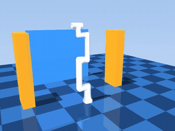
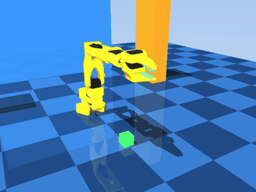
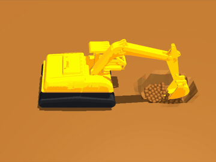
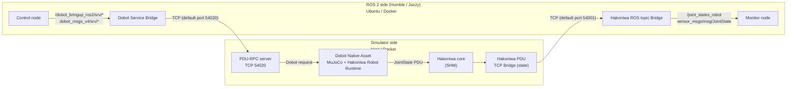
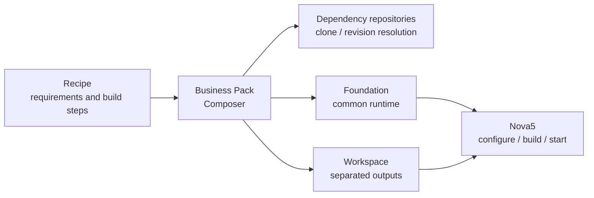

# hakoniwa-robot-arm

English | [日本語](README.ja.md)

<table>
  <tr>
    <td align="center"></td>
    <td align="center"></td>
    <td align="center"></td>
  </tr>
  <tr>
    <td align="center">DOBOT Nova5: joint trajectory</td>
    <td align="center">SO-101: cube pick and place</td>
    <td align="center">Excavator: digging (experimental)</td>
  </tr>
</table>

`hakoniwa-robot-arm` is a simulation development platform for building and running robot arm simulators on Hakoniwa, from ROS robot models described in URDF / Xacro.

It converts a robot model to MuJoCo and combines it with the [Hakoniwa Robot Runtime](https://github.com/hakoniwalab/hakoniwa-robot-runtime), so you can control the joints and read their state without the real robot. Nova5 can be used in three stages: Hakoniwa alone, Hakoniwa driven from ROS 2, and a real robot connected from Ubuntu host-ros2. From ROS 2, the official Dobot services `dobot_msgs_v4/srv/*` and `/joint_states_robot` are used, and the official demo runs unmodified against Hakoniwa.

Current status:

| Robot | Status |
| --- | --- |
| DOBOT Nova5 | Verified on the earlier path with Ubuntu 24.04 native host-ros2, Windows 11 native host-standalone / host+Docker (Jazzy), macOS host+docker (Jazzy) and Linux arm64 docker-only (Humble / Jazzy). For the verification status of the Dobot virtual service path, see [here](ros2_packages/hakoniwa_dobot/README.md#検証済みと未検証) (Japanese). |
| FAIRINO FR5 | Sources and tools published. Being verified. |
| SO-101 follower | Sources and tools published. Being verified. |
| MathScavator9000 Excavator | Driving verified on a macOS host, WSL2 Ubuntu 24.04 and Windows 11 native (all headless). The Viewer and other environments are not verified; digging is experimental. See the [Recipe](recipes/excavator/README.md). |

For the settings and procedures of each robot, see [Supported robots](docs/reference/robots.md).

Most documents under `docs/` are in Japanese.

## Getting started

Start from "Create the checkout workspace" in [Quick start](#quick-start). You clone only the following two repositories by hand, side by side in the same parent directory:

- `hakoniwa-business-pack` — provides the Composer, the Workspace and the Foundation.
- `hakoniwa-robot-arm` — provides the robot-specific Recipes, settings and applications.

The other repositories and the robot models are fetched later by the Recipe steps, as needed. After cloning the two repositories, choose the procedure for your environment: host-standalone, windows-host-standalone, windows-host-docker, host-ros2, host+docker or docker-only.

## Documentation

The documents are split by purpose. Start from the [user guide](docs/README.md) and choose the procedure for your environment.

- [Procedures](docs/procedures/README.md): setup, build, operation, ROS 2 operations
- [Design documents](docs/design/README.md): Recipes, profiles, generated files, the ROS 2 connection
- [Reference](docs/reference/README.md): supported robots, Model Forge
- [License information](docs/license/README.md): dependencies, robot models, redistribution policy

## What you can do

- Convert robot models described in URDF / Xacro to MuJoCo
- Simulate the physics of a robot arm in MuJoCo
- Control the joints through the Hakoniwa Robot Runtime
- [Operate Nova5 with the official Dobot ROS 2 services](docs/procedures/ros2/arm-operations.md) (Hakoniwa by default; the real robot, `real` / `both`, on Ubuntu host-ros2 is an advanced setup)
- Read the state through ROS 2 `/joint_states_robot`
- Run the official `dobot_demo/demo.py` unmodified in `virtual` mode (do not run it with the real robot or `both`: it includes a 50° motion)
- A ROS 2 environment in Docker
- Watch the simulation in the MuJoCo Viewer on the host

## Architecture

The simulator side and the ROS 2 side are separated by TCP. The official Dobot ROS services go through the Service Bridge and PDU-RPC to the Dobot Native Asset; the joint states go from the existing TCP/PDU Bridge to `/joint_states_robot` (remapped). ROS services and topics end on the ROS 2 side.



### Simulator side

On the simulator side, MuJoCo and the Hakoniwa Robot Runtime simulate the physics, receive the Dobot services and output the joint states. PDU-RPC sends the service requests to the Native Asset, and the Hakoniwa PDU TCP Bridge relays the joint states in shared memory to the ROS 2 side. You can run with the Viewer or headless.

### ROS 2 side

By default, `dobot.launch.py` starts the Hakoniwa Service Bridge and topic Bridge together. Control uses `dobot_msgs_v4/srv/GetAngle`, `MovJ`, `ServoJ` and others; observation uses `sensor_msgs/msg/JointState`. The joint mode of the virtual `MovL` is an approximation in joint space, not a Cartesian straight line, and the virtual `DO` provides only the state / pulses of outputs 1 to 24, with no physical gripper. See [Supported APIs and safety notes](docs/procedures/ros2/arm-operations.md).

### Hakoniwa Robot Runtime

The Hakoniwa Robot Runtime is a common base that assembles each robot's behaviour and communication from definition files. Mainly from the following inputs, it builds the physical model, control inputs, state outputs and communication paths:

- the Hakoniwa asset manifest
- the MuJoCo model (MJCF)
- PDU definitions and PDU communication definitions
- actuator, controller and sensor settings

This repository owns the values and the combination of settings files for each supported robot; the meaning of each item, the references between them and the validation rules are defined in `hakoniwa-robot-runtime`. Normal use needs no change to these settings. To change a robot's configuration or control method, see:

- [Robot Runtime Configuration](https://github.com/hakoniwalab/hakoniwa-robot-runtime/blob/main/docs/configuration.md): settings and references of the asset manifest, runtime, actuators, controllers, state outputs, PDUs and endpoints
- [Robot Runtime Design](https://github.com/hakoniwalab/hakoniwa-robot-runtime/blob/main/docs/design.md): the runtime's responsibilities, internal structure and boundary with the adapters
- [Runtime-owned JSON Schemas](https://github.com/hakoniwalab/hakoniwa-robot-runtime/tree/main/schemas): machine-readable settings schemas owned by the runtime
- [Hakoniwa PDU Endpoint Schemas](https://github.com/hakoniwalab/hakoniwa-pdu-endpoint/tree/main/config/schema): the reference for PDU definitions, PDU types, endpoints, caches and communication formats

As a concrete example, Nova5 uses the following files. FR5 / SO-101 / MathScavator9000 have their own settings under `recipes/<robot>/`.

| Setting | Nova5 file | Main role |
| --- | --- | --- |
| Asset Manifest | [`recipes/nova5/asset-manifest.json`](recipes/nova5/asset-manifest.json) | The entry that ties together the model, PDUs, endpoint and runtime components |
| Runtime | [`recipes/nova5/config/runtime.json`](recipes/nova5/config/runtime.json) | Common settings of the actuator runtime and the command timeout |
| MuJoCo actuator | [`recipes/nova5/actuator.yaml`](recipes/nova5/actuator.yaml) | `kp`, `dampratio` and `ctrlrange` of the position actuators. A gain change needs a new Forge; for tuning, see [Model Forge](docs/reference/model-forge.md#4-kpとdampratioの調整) (Japanese) |
| Actuator / Controller / State Output | [`recipes/nova5/config/`](recipes/nova5/config) | Joint binding, trajectory control, joint state output |
| PDU Definition / Types | [`recipes/nova5/config/pdu/`](recipes/nova5/config/pdu) | The PDU robot, channels and message types Nova5 uses |
| Endpoint | [`recipes/nova5/config/endpoint/nova5_endpoint.json`](recipes/nova5/config/endpoint/nova5_endpoint.json) | The PDU definition and the choice of communication backend |

Do not edit by hand the `launcher.json` that `nova5.py configure` generates in the work directory, or the MJCF that Forge generates. The Dobot configuration switches the launcher with a [dedicated conversion tool](docs/procedures/ros2/dobot-build.md); apply it again after each configure. For which changes need Forge, configure or build, where things are generated and how to check a change, see [Configuration workflow](docs/design/configuration-workflow.md).

## License and robot models

Except for third-party works with their own license notices, the [Apache License 2.0](LICENSE) at the root applies to this repository's own source code, settings, tools and documents. The Hakoniwa OSS and external OSS it uses are under their own licenses; see the [dependency license list](docs/license/dependencies.md).

The robot models themselves (upstream URDF, Xacro, MJCF, meshes, CAD, textures) and the derivatives Forge generates are not included in or redistributed from this repository. Users fetch them from fixed revisions and generate them under `$HAKONIWA_WORK_DIR/model-forge/`. This repository keeps only the definitions for fetching and converting them, the Hakoniwa-specific settings and the records of the license investigation.

For each model's source, fixed revision, the license declarations found and the notes on redistribution, see [Robot model license information](docs/license/robot-models.md). It covers Nova5, FR5, SO-101 and MathScavator9000. The Apache License 2.0 of this repository does not automatically apply to third-party models or their derivatives.

Each model's `source.yaml` and `LICENSE_INFO.yaml` divide the responsibilities as follows. The conversion and normalization steps are kept in the corresponding Forge Recipe and tools.

| File | Responsibility |
| --- | --- |
| `source.yaml` | The fetch definition: the upstream repository, the fixed revision and the files Forge fetches |
| `LICENSE_INFO.yaml` | The investigation record: the license evidence found at the fixed revision, open points, the redistribution decision and what it requires |

These files contain no model and are not legal advice. Before redistributing an upstream model or a Forge output, check the model's record and the upstream license text, NOTICE and package metadata.

## Relation to the Hakoniwa Business Pack

[hakoniwa-business-pack](https://github.com/hakoniwalab/hakoniwa-business-pack) is the Composer that manages the dependencies, the common runtime environment and the build steps of Hakoniwa simulations. This repository provides the robot-specific models, settings and applications, and uses the Business Pack's Workspace, Foundation and Recipe mechanisms to build and separate the environments.



### Workspace

A Workspace separates the Foundation in use and the generated files from other working environments. `workspace.py enter --workdir <path>` opens a dedicated shell and sets the chosen path as `HAKONIWA_WORK_DIR`. The child shell starts at the root of the `hakoniwa-business-pack` repository (where the `tools/` directory is). The Foundation, Forge and Recipe builds, settings, logs and sessions are generated under the chosen work directory, not the current directory.

### Foundation

The Foundation is Hakoniwa's common runtime environment, reused by several simulations. For Nova5, the Hakoniwa core, the PDU Endpoint, the PDU Bridge, the Python API, the Launcher and the runtime settings are built under `HAKONIWA_WORK_DIR/foundation/`.

### Recipe

A Recipe is a YAML file that describes what is needed, which revisions to use, and what to build and check. The Business Pack's `tools/recipe.py` reads a Recipe and does the following:

- `plan`: shows the planned clones, checkouts, reuse and Foundation builds
- `configure`: prepares the dependency repositories and builds the required Foundation and Python dependencies
- `doctor`: checks that the Foundation and the Recipe's dependencies are ready to run

This repository's `tools/recipe/<robot>.py` uses that environment to run each robot's Forge, configure, build, start and stop. For the entry points and how to swap them, see [Supported robots](docs/reference/robots.md).

## Verified environments

| Item | Verified with |
| --- | --- |
| Host OS | macOS (Apple Silicon) / Ubuntu 24.04 / Windows 11 (native host-only / host+Docker) |
| ROS 2 | Humble / Jazzy |
| MuJoCo | 3.16.0 |
| Python on the Hakoniwa side | 3.12 |
| Build system | CMake / colcon |

With macOS host+docker, ROS 2 runs in a Docker container and the Hakoniwa Native Asset runs on the host. On Windows 11, the Hakoniwa-only runtime and the earlier ROS topic path are verified, but the [Windows host+Docker procedure with the Dobot Native Asset / RPC](docs/procedures/windows-host-docker/build.md) is not verified. Check the success criteria of each stage before going on, and do not take the earlier verification as verification of the new service path.

The earlier path with Ubuntu 24.04 native host-ros2 is verified. For the verification status of the Dobot virtual service path on each platform, see the [Dobot notes](ros2_packages/hakoniwa_dobot/README.md) (Japanese).

## Prerequisites

Install the following on the host, according to the configuration you choose.

| Software | Use |
| --- | --- |
| Git | All configurations: to fetch this repository and the Business Pack |
| CPython 3.12 | host-standalone / host-ros2 / host+docker: to run the Business Pack, the Foundation and the Recipe tools. It must start as `python3.12` |
| CMake and a C/C++ toolchain | host-standalone / host-ros2 / host+docker: to build the Foundation and the Nova5 simulator |
| Docker | host+docker or docker-only: to run ROS 2 |

macOS also needs the Xcode Command Line Tools, and Ubuntu a standard build environment with a C/C++ compiler.

Check Git in every configuration:

```bash
git --version
```

For host-standalone, host-ros2 or host+docker, also check Python and the build environment on the host:

```bash
python3.12 --version
cmake --version
```

For host+docker or docker-only, also check Docker:

```bash
docker --version
```

## Configurations

### Stage 1: Hakoniwa alone, without ROS 2

The same Nova5 model runs in the Hakoniwa Runtime and the MuJoCo Viewer, with Hakoniwa PDUs and its own trajectory scripts. Neither the official ROS services nor the PDU-RPC for Dobot are needed.

| Environment | Configuration |
| --- | --- |
| Ubuntu / macOS host | `host-standalone` (Bash; on macOS the prerequisites come from Homebrew) |
| Windows 11 native host | `windows-host-standalone` (PowerShell) |

### Stage 2: Hakoniwa driven from ROS 2

The environments differ, but all of them connect the Nova5 on the Hakoniwa side with the official Dobot services on the ROS 2 side, and run the unmodified `dobot_demo demo` **on Hakoniwa only**. The ROS launch defaults to Hakoniwa (`virtual`), so users do not have to choose a real-robot mode. `dobot_msgs_v4` and `dobot_demo` are built from the official sources, and the `dobot-types` needed to talk to Hakoniwa are generated. The real-robot driver is not built.

| Environment | Configuration |
| --- | --- |
| Ubuntu host (ROS 2 and Hakoniwa on the same host) | `host-ros2` |
| macOS host + Ubuntu ROS 2 container | `host+docker` |
| Windows 11 native host + Ubuntu ROS 2 container | `windows-host-docker` (the build and integration of the Dobot Native Asset / RPC are not verified) |
| Ubuntu / macOS / Windows host + a single Ubuntu container | `docker-only` (headless on macOS / Windows; the Bash procedure from a Windows host is not verified) |

### Stage 3: also connect the real robot from Ubuntu host-ros2 (advanced)

After checking Hakoniwa with `host-ros2` in Stage 2, **additionally build** the official real-robot driver and choose `real` (real robot only) or `both` (real robot and Hakoniwa). Operation with the real robot is verified on Ubuntu native. The official demo includes a 50° absolute move, so it is not sent to the real robot; check with small motions from the current pose instead.

## Quick start

### Common: create the checkout workspace

In the parent directory of your choice, create an empty directory and clone the Business Pack and this repository directly into it:

```bash
mkdir -p hakoniwa-robot-arm-workspace
cd hakoniwa-robot-arm-workspace
git clone https://github.com/hakoniwalab/hakoniwa-business-pack.git
git clone https://github.com/teras-project/hakoniwa-robot-arm.git
```

These two repositories are all you need at this point. With the standard layout, the profiles used later detect this side-by-side layout automatically. The other repositories Nova5 needs are fetched automatically by the Recipe's `configure` or by the ROS 2 workspace's `build`.

### Stage 1: check with Hakoniwa alone (no ROS 2)

#### Ubuntu / macOS: host-standalone

1. [Hakoniwa-only setup](docs/procedures/host-standalone/setup.md)
2. [Hakoniwa-only build](docs/procedures/host-standalone/build.md)
3. [Hakoniwa-only start and check](docs/procedures/host-standalone/operation.md)

Neither OS needs ROS 2 or Docker. At the beginning of the setup procedure, choose the prerequisite commands for Ubuntu (`apt`) or macOS (Homebrew).

#### Windows native: windows-host-standalone

1. [Windows native Hakoniwa-only setup](docs/procedures/windows-host-standalone/setup.md)
2. [Windows native Hakoniwa-only build](docs/procedures/windows-host-standalone/build.md)
3. [Windows native Hakoniwa-only start and check](docs/procedures/windows-host-standalone/operation.md)

### Stage 2: drive Hakoniwa from ROS 2

Choose one environment below and go through setup → build → operation. The common goal is to **run the official `dobot_demo demo` on Hakoniwa, without the real robot**.

#### Ubuntu host: host-ros2

1. [Host ROS 2 setup](docs/procedures/host-ros2/setup.md)
2. [Host ROS 2 build](docs/procedures/host-ros2/build.md)
3. [Host ROS 2 start and check](docs/procedures/host-ros2/operation.md)

#### macOS host + Docker: host+docker

On macOS, the Nova5 Runtime and the MuJoCo Viewer run on the host, and the ROS 2 Bridge and ROS nodes in a Docker container. The host and Docker are connected over TCP.

1. [host+docker setup](docs/procedures/host-docker/setup.md)
2. [host+docker build](docs/procedures/host-docker/build.md)
3. [host+docker start and check](docs/procedures/host-docker/operation.md)

When a person operates it, the MuJoCo Viewer on the host can be used. For CI or automated checks without a display, choose headless.

#### Windows host + Docker: windows-host-docker

The Windows 11 native Runtime with ROS 2 Jazzy in Docker Desktop. The Dobot virtual services are the main path, but the Windows native build and integration are not verified. Do not go on when a stage's check fails.

1. [Windows host+Docker setup](docs/procedures/windows-host-docker/setup.md)
2. [Windows host+Docker build](docs/procedures/windows-host-docker/build.md)
3. [Windows host+Docker start and check](docs/procedures/windows-host-docker/operation.md)

#### Ubuntu / macOS / Windows host: docker-only

Choose docker-only to check with Git and Docker only, without installing CPython 3.12, CMake or ROS 2 on the host. Nova5 and ROS 2 run in the same single Ubuntu container.

1. [docker-only setup](docs/procedures/docker-only/setup.md)
2. [docker-only build](docs/procedures/docker-only/build.md)
3. [docker-only start and check](docs/procedures/docker-only/operation.md)

A native Linux host can use the Viewer. Docker Desktop on macOS runs headless in the native architecture. The Bash procedure from a Windows host is not verified.

### Stage 3: also connect the real robot with Ubuntu host-ros2 (advanced)

Only after the Hakoniwa demo with `host-ros2` in Stage 2, go on to [adding the real-robot driver and switching to `real` / `both`](docs/procedures/host-ros2/real.md). Do not run the unmodified official demo on the real robot.

## Repository layout

| Path | Responsibility |
| --- | --- |
| `apps/` | Arm simulator applications on the common runtime |
| `recipes/nova5/` | Nova5 manifest, PDU, control and Forge settings |
| `recipes/ros2/` | Recipe for the ROS 2 TCP Bridge |
| `ros2_packages/` | Sample ROS 2 nodes built with standard colcon |
| `sources/models/` | Where upstream models come from, their sources, and the normalization steps in the work directory. The fetched models are not included |
| `tools/` | Forge, Recipe, environment generation and control tools |
| `docker/` | Containers for ROS 2 Humble / Jazzy |
| `docs/procedures/` | Per-environment procedures, followed in order |
| `docs/design/` | Design notes on Recipes, profiles, generated files and connections |
| `docs/reference/` | Reference on supported robots and Model Forge |
| `docs/license/` | License records of dependencies and robot models |

Models fetched and generated by Forge are not placed in the source tree; they are kept under `HAKONIWA_WORK_DIR/model-forge/`. The ROS 2 venv, build, install and log go under `HAKONIWA_ROS2_WS`.

## Required repositories

As a rule, place the repositories in the same parent directory. Only the Business Pack and this repository are cloned by hand at first.

| Repository | How it is prepared | Use |
| --- | --- | --- |
| `hakoniwa-business-pack` | Cloned by the user | Composer, Workspace, Foundation |
| `hakoniwa-robot-arm` | Cloned by the user | This repository |
| `hakoniwa-core-pro` | Fetched by the runtime Recipe's `configure` | Hakoniwa core and shared memory |
| `hakoniwa-pdu-endpoint` | Fetched by the runtime Recipe and the ROS 2 workspace | PDU communication endpoint |
| `hakoniwa-pdu-bridge-core` | Fetched by the runtime Recipe's `configure` | Host-side TCP Bridge |
| `hakoniwa-pdu-python` | Fetched by the runtime Recipe's `configure` | Python Launcher and PDU API |
| `hakoniwa-robot-runtime` | Fetched by the runtime Recipe's `configure` | Common robot runtime |
| `hakoniwa-mujoco-robots` | Fetched by the runtime / Forge Recipe's `configure` | Common MuJoCo functions |
| `hakoniwa-mbody-registry` | Fetched by the Forge Recipe's `configure` | Model fetch and conversion tools |
| `hakoniwa-pdu-ros` | Fetched by the ROS 2 workspace's `build` | ROS 2 Bridge packages |

The repositories fetched automatically and their revisions are recorded in the Recipes. Before running, `tools/recipe.py plan` shows the planned clones, checkouts, reuse and Foundation builds.

```text
hakoniwa-robot-arm-workspace/
├── hakoniwa-business-pack/       # cloned by hand
├── hakoniwa-robot-arm/           # cloned by hand
├── hakoniwa-core-pro/            # fetched by configure
├── hakoniwa-pdu-endpoint/        # fetched by configure / build
├── hakoniwa-pdu-bridge-core/     # fetched by configure
├── hakoniwa-pdu-python/          # fetched by configure
├── hakoniwa-robot-runtime/       # fetched by configure
├── hakoniwa-mujoco-robots/       # fetched by configure
├── hakoniwa-mbody-registry/      # fetched by configure
├── hakoniwa-pdu-ros/             # fetched by the ROS 2 build
├── work-host/                    # host-side Foundation, Forge, Runtime and ROS 2 outputs
│   └── ros2/                     # ROS 2 base environment for host-ros2 / host+docker
└── work-docker-jazzy/            # docker-only Foundation, Forge and Runtime outputs
    └── ros2/                     # ROS 2 base environment for docker-only
```

The main output locations are set as follows:

| Environment variable | Use |
| --- | --- |
| `HAKONIWA_COMPOSER` | Root of the Composer repository. Detected automatically with the standard layout; no need to set it |
| `HAKONIWA_WORK_DIR` | Foundation, Forge and Recipe outputs. Set to the chosen value by `workspace.py enter --workdir` |
| `HAKONIWA_ROS2_WS` | ROS 2 venv, build, install and log. `docker/run.bash` defaults it to the chosen `HAKONIWA_WORK_DIR/ros2` |
| `HAKONIWA_ROS2_TCP_CONFIG` | Host-side path that passes the ROS 2 TCP settings generated on the host to Docker. Set by the user before `docker/run.bash` |

## More information

- [Detailed user guide by environment](docs/README.md)
- [Nova5 runtime Recipe](recipes/nova5/nova5-joint-trajectory-control.yaml)
- [Nova5 model Forge Recipe](recipes/nova5/nova5-model-forge.yaml)
- [Robot model license information (Nova5 / FR5 / SO-101 / MathScavator9000)](docs/license/robot-models.md)
- [ROS 2 Bridge Recipe](recipes/ros2/arm-ros2-topic-bridge.yaml)
- [Docker settings](docker/env.bash)

## License and model sources

The source code of this repository is provided under the [Apache License 2.0](LICENSE).

For the robot models and their derivatives handled here, check the licenses and terms of use of each upstream project. This repository does not redistribute the models or the outputs Forge generates.

For each model's investigation results, usage notes and redistribution decisions, see [Robot model license information](docs/license/robot-models.md).
